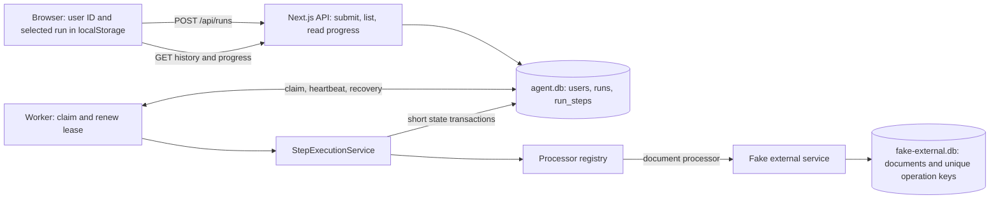

# Durable agent execution

## Implemented approach

The API accepts work; a separate Node.js worker executes it. SQLite is both the
persistent task store and a small queue. The browser observes stored state and
can disappear without cancelling execution. There is no in-memory task queue
that must survive an API or worker restart.

Both databases live on local persistent disk. The external database deliberately
has its own transaction boundary: creating a document and committing an agent
step cannot be made one local transaction.

## Task and step lifecycle

1. Submission creates the user if needed, a queued run, and only its first step,
   in one transaction. The API responds with `202 { runId }` after commit.
2. A worker atomically claims the oldest eligible task using `UPDATE ... RETURNING`.
   A new random lease token expires after 15 seconds and renews every 5 seconds.
3. `StepExecutionService` loads the first unfinished step and records its start
   and attempt count. It finds a processor by the stored class name and executes
   it outside any task database transaction.
4. The processor returns JSON output and the next processor's name, or a final
   result. Output becomes the next step's input. The service validates that the
   continuation is registered.
5. Storage atomically completes the current step and creates its successor, or
   completes the run. There is no committed state where a successful nonfinal
   step lacks its continuation. Completion notifications follow commit.

The sample processors still follow five simulated actions. Only the processor
chooses its successor; neither the queue nor executor assumes a five-step plan.
Class names are persisted and explicitly preserved against bundler minification.
Renaming a processor requires a database migration. JSON input/output contracts
also need compatibility handling if changed while old tasks exist.

## Recovery and guarantees

SIGINT/SIGTERM aborts the worker's current execution and releases its lease.
SIGKILL leaves the lease on disk; another worker can claim it after expiry.
Completed steps are skipped, while unfinished steps may execute again. Task
acceptance, progress, results, and errors survive reopening the database.

Every step start, completion, and failure transaction checks the worker token and
lease expiry. An old worker cannot save progress after its lease is lost, even
if it resumes later. Leases protect database writes; they cannot forcibly stop
an external request already in progress.

The document processor passes its stored `idempotency_key` on every attempt.
The fake external service checks the unique key and inserts the document in one
transaction. Same key and input returns the original document; changed input is
rejected. This handles a crash after document creation but before step commit,
including overlapping calls from different workers. It depends on the external
service honoring the key: this is not a general exactly-once execution guarantee.

The task database uses WAL and `synchronous=FULL`. The external database uses the
default rollback journal and `synchronous=FULL`. Both use short transactions and
a five-second busy timeout. Commit durability assumes the filesystem and storage
honor synchronization requests; deleting the files or losing the disk is outside
these guarantees.

## Browser behavior and identity

History is filtered by `user_id`; reading another user's task returns 404.
A UUID in localStorage identifies the user and can be copied or entered manually.
The selected task is saved separately per user. Reloading restores observation;
changing tasks cancels old polling requests without cancelling execution.
History polls every 1.5 seconds; active task progress polls every 750 ms.
Connection errors are separate from persisted task failures and reads retry.
The timeline is reconstructed from step state, not an immutable event log, so
it shows the latest attempt timestamps rather than every historical attempt.

This identity model is intentionally not authentication: anyone with an ID can
use it. The external document/reset panel remains a shared development tool.

## Tradeoffs and limitations

- SQLite keeps the prototype self-contained. Multiple workers can coordinate on
  the same local database, but SQLite has one writer; this is not a distributed
  queue across hosts or ephemeral serverless instances.
- The worker processes one task at a time. Synchronous SQLite calls briefly block
  its event loop; long CPU work can delay heartbeats and cause lease loss.
- Process interruption is retried; application errors mark tasks failed. There
  is no retry policy, backoff, attempt limit, cancellation API, or manual retry UI.
- Submission is not idempotent. If its response is lost, inspect history before
  submitting again; repeating POST can create a second task.
- History has no pagination or retention policy. Step output carries cumulative
  context and has no size limit or schema version. Inputs are assumed small.
- The fake external service runs as an imported library, not over a network.
  Tests reproduce the independent-commit failure window but not network ambiguity.
- Legacy JSON documents import once without operation keys. Deduplication cannot
  retroactively cover calls interrupted before this upgrade. Development reset
  removes documents and keys; replaying a task afterwards may recreate a document.
- There are no backups, disk-loss recovery, metrics, or immutable audit events.
  The API crash button terminates only Next.js; worker crash testing is separate.

## Proposed production development (not implemented)

Use authenticated principals for task access, define task and step schema
versions, add submission idempotency, bounded retries and cancellation semantics,
and implement reconciliation for tools without idempotency support. Introduce
structured logs, attempt history, metrics, pagination, retention, and backups.

For multiple hosts or higher write throughput, move claims and state to a shared
transactional database or evaluate a durable workflow engine. A broker can wake
workers, but persisted workflow state and external-operation idempotency remain
necessary. Define execution and timeout policies before expanding concurrency.

## Validation

`pnpm test` covers atomic continuation, rollback, access scoping, processor
registration, lease renewal and stale-write fencing, real worker SIGKILL recovery,
parallel external calls, legacy import, and the external-commit/step-commit crash
window. `pnpm typecheck`, `pnpm lint`, and `pnpm build` check the application.
See README for startup and manual failure scenarios.
