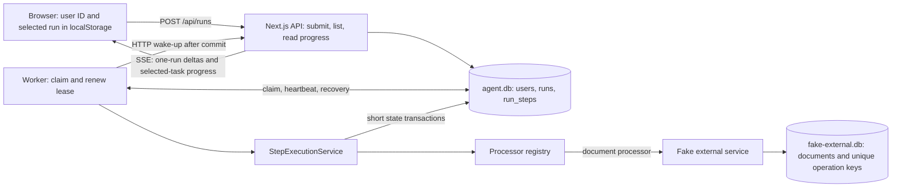

# Durable agent execution

## Implemented approach

The API accepts work; a separate Node.js worker executes it. SQLite is both the
persistent task store and a small queue. The browser observes stored state and
can disappear without cancelling execution. There is no in-memory task queue
that must survive an API or worker restart.

Both databases live on local persistent disk. The external database deliberately
has its own transaction boundary: creating a document and committing an agent
step cannot be made one local transaction.

## Task and step lifecycle

1. Submission creates the user if needed, a queued run, and only its first step,
   in one transaction. The API responds with `202 { runId }` after commit.
2. A worker atomically claims one eligible step using `UPDATE ... RETURNING`
   inside a transaction. Claiming records the attempt/start and updates the run's
   status. Its random step lease expires after 15 seconds and renews every 5 seconds.
3. `StepExecutionService` receives that claimed step, finds its processor by class
   name, and executes it outside any task database transaction.
4. The processor returns JSON output and the next processor's name, or a final
   result. Output becomes the next step's input. The service validates that the
   continuation is registered.
5. Storage checks step ownership and atomically completes it and creates its
   successor, or completes the run. The successor inherits `user_id`, is pending
   until `available_at`, and will obtain a new lease when claimed by any worker.
   There is no run-wide execution lock or worker affinity across steps.
   Completion notifications follow commit.

`run_steps.user_id` is enforced by a composite foreign key to `(runs.id, runs.user_id)`.
A unique partial index permits only one pending/running step per run, so processors
remain sequential within a run. Different runs can have independently leased steps.
Migration 3 backfills ownership and transfers active leases from runs to steps;
inputs, outputs, attempt counts, and idempotency keys are retained. All API/worker
processes must be stopped for this schema upgrade and restarted with the new code.

The sample processors still follow five simulated actions. Only the processor
chooses its successor; neither the queue nor executor assumes a five-step plan.
Class names are persisted and explicitly preserved against bundler minification.
Renaming a processor requires a database migration. JSON input/output contracts
also need compatibility handling if changed while old tasks exist.

## Recovery and guarantees

SIGINT/SIGTERM aborts the worker's current execution and returns its unfinished step to pending and releases its lease.
SIGKILL leaves the lease on disk; another worker can claim it after expiry.
Completed steps are skipped, while unfinished steps may execute again. Task
acceptance, progress, results, and errors survive reopening the database.

The claim/start transaction assigns a step token. Completion and failure
transactions check that step token and expiry before changing the step or its run. An old worker cannot save progress after its lease is lost, even
if it resumes later. Leases protect database writes; they cannot forcibly stop
an external request already in progress.

The document processor passes its stored `idempotency_key` on every attempt.
The fake external service checks the unique key and inserts the document in one
transaction. Same key and input returns the original document; changed input is
rejected. This handles a crash after document creation but before step commit,
including overlapping calls from different workers. It depends on the external
service honoring the key: this is not a general exactly-once execution guarantee.

The task database uses WAL and `synchronous=FULL`. The external database uses the
default rollback journal and `synchronous=FULL`. Both use short transactions and
a five-second busy timeout. Commit durability assumes the filesystem and storage
honor synchronization requests; deleting the files or losing the disk is outside
these guarantees.

## Browser behavior and identity

History is filtered by `user_id`; reading another user's task returns 404.
A UUID in localStorage identifies the user and can be copied or entered manually.
The selected task is saved separately per user. Reloading restores observation;
changing tasks closes old SSE connections without cancelling execution.
The worker sends best-effort HTTP notifications containing `userId`, `runId`,
and `stepId` from its claimed step after state commits. The API validates the
triple against stored ownership and wakes only that user's subscribers.
History SSE sends one changed run per journal entry, not the loaded list. INSERT
and UPDATE triggers append summaries to `run_changes` in the same transaction as
task state. REST pages include a journal watermark captured with their rows;
SSE starts after that watermark and resumes from the last processed cursor.
A per-run revision prevents late REST/replayed rows overwriting newer state,
including changes within one millisecond. Pagination races are handled by buffering
deltas during page fetches and merging them after the REST response.

Journal reads are indexed by `(user_id, seq)`, bounded to 100 entries, and driven
by stream demand. Idle reconciliation checks only the journal tail every 15 seconds,
so a lost wake-up does not require a full history read. Selected-task SSE still
uses a snapshot of that one task and closes at a terminal status. Its reconnect
returns current progress. Notification failure never fails agent execution.

Connection errors are separate from persisted task failures and reads retry.
The timeline is reconstructed from step state, not an immutable event log, so
it shows the latest attempt timestamps rather than every historical attempt.

This identity model is intentionally not authentication: anyone with an ID can
use it. The external document/reset panel remains a shared development tool.

## Tradeoffs and limitations

- SQLite keeps the prototype self-contained. Multiple workers can coordinate on
  the same local database, but SQLite has one writer; this is not a distributed
  queue across hosts or ephemeral serverless instances.
- Each worker process executes one step at a time. It returns to the shared queue
  after every step; there is no in-process concurrency pool. Synchronous SQLite calls briefly block
  its event loop; long CPU work can delay heartbeats and cause lease loss.
- Process interruption is retried; application errors mark tasks failed. There
  is no retry policy, backoff, attempt limit, cancellation API, or manual retry UI.
- Submission is not idempotent. If its response is lost, inspect history before
  submitting again; repeating POST can create a second task.
- History uses a `(created_at, id)` keyset cursor and a matching owner index.
  SSE sends a single changed summary independent of the loaded range. The change
  journal currently has no retention policy or cursor-expiry protocol. Step output carries cumulative
  context and has no size limit or schema version. Inputs are assumed small.
- The fake external service runs as an imported library, not over a network.
  Tests reproduce the independent-commit failure window but not network ambiguity.
- Legacy JSON documents import once without operation keys. Deduplication cannot
  retroactively cover calls interrupted before this upgrade. Development reset
  removes documents and keys; replaying a task afterwards may recreate a document.
- Notifications use a process-local hub and a configurable API URL (default
  localhost:3000). Multiple API replicas require shared pub/sub for immediate
  delivery; 15-second reconciliation covers missed notifications. The prototype
  wake-up endpoint is not authenticated and is intended for a trusted local setup.
- There are no backups, disk-loss recovery, metrics, or immutable audit events.
  The API crash button terminates only Next.js; worker crash testing is separate.

## Proposed production development (not implemented)

Use authenticated principals for task access, define task and step schema
versions, add submission idempotency, bounded retries and cancellation semantics,
and implement reconciliation for tools without idempotency support. Introduce
structured logs, attempt history, authenticated worker notifications, shared pub/sub, metrics, journal retention with cursor-expiry/resync, and backups.

For multiple hosts or higher write throughput, move claims and state to a shared
transactional database or evaluate a durable workflow engine. A broker can wake
workers, but persisted workflow state and external-operation idempotency remain
necessary. Define execution and timeout policies before expanding concurrency.

## Validation

`pnpm test` covers atomic continuation, rollback, access scoping, processor
registration, per-step lease renewal and stale-write fencing, owner-consistent
migration, handoff between worker connections, real worker SIGKILL recovery,
parallel external calls, legacy import, and the external-commit/step-commit crash
window. `pnpm typecheck`, `pnpm lint`, and `pnpm build` check the application.
The HTTP integration test also checks live worker-to-SSE delivery before the
reconciliation timer, failure delivery, stream ownership, and reconnect snapshots.
See README for startup and manual failure scenarios.
